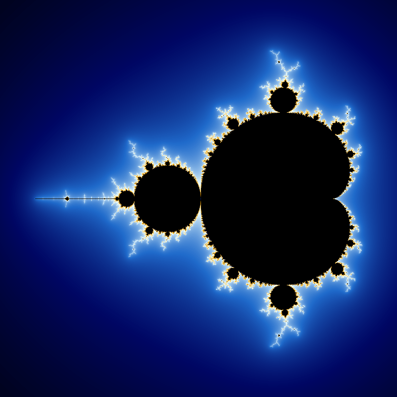
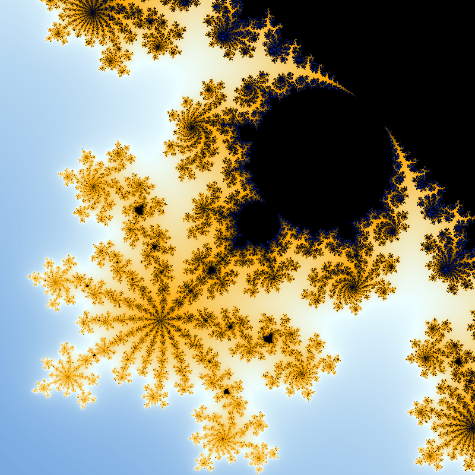
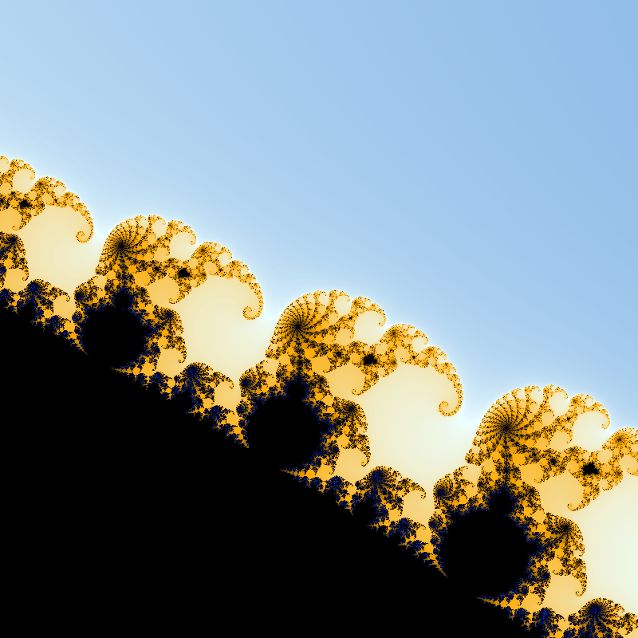
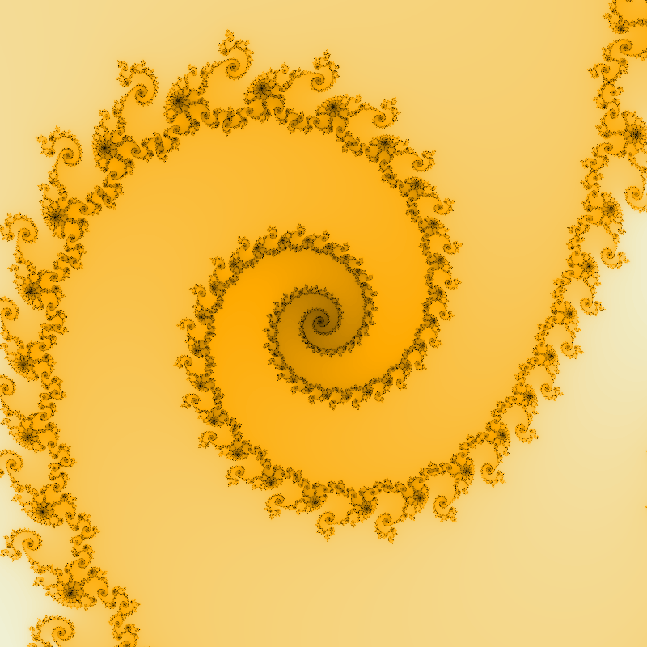
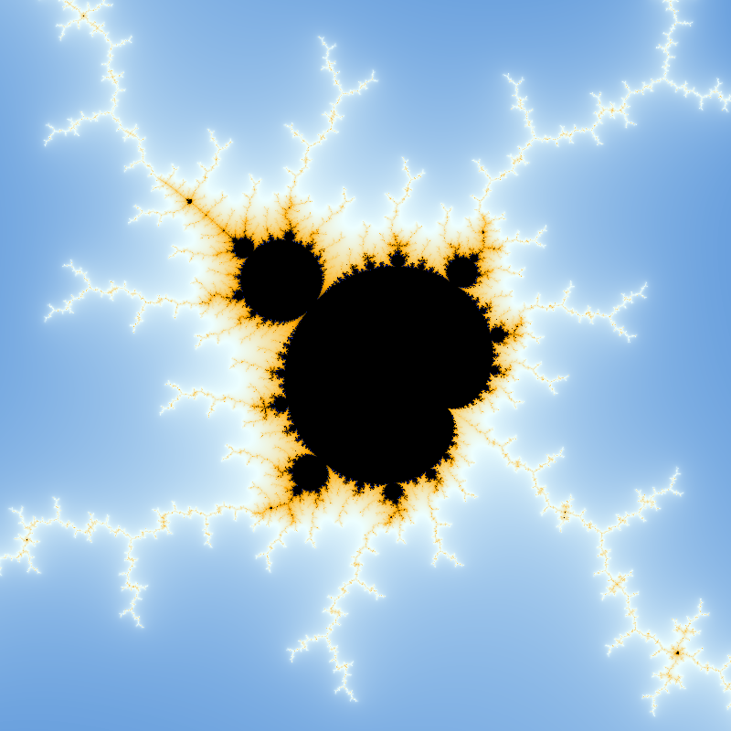
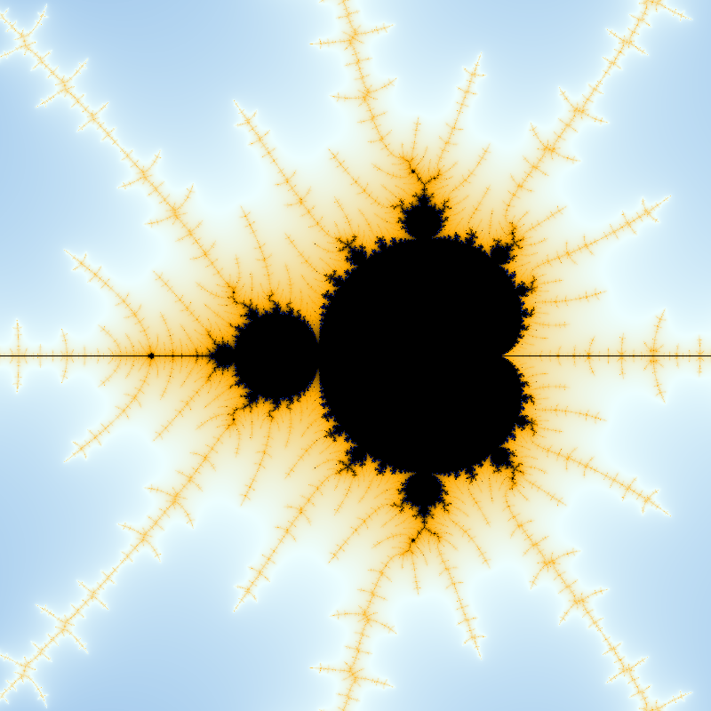
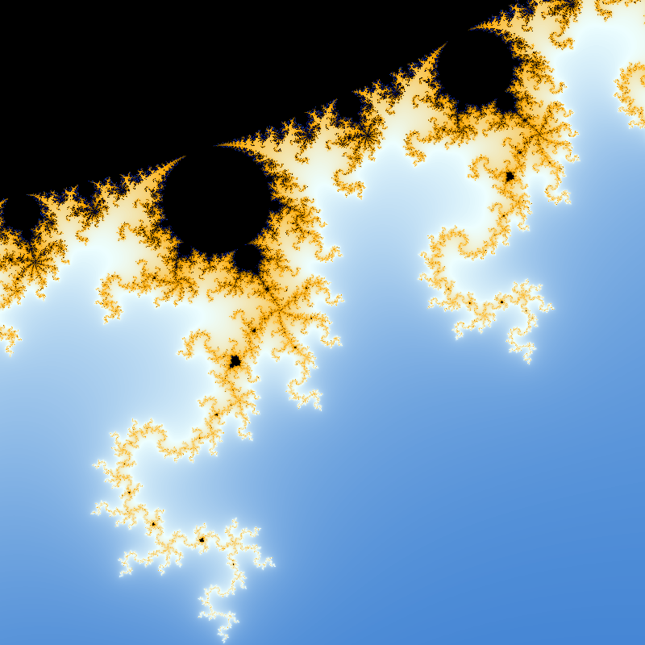
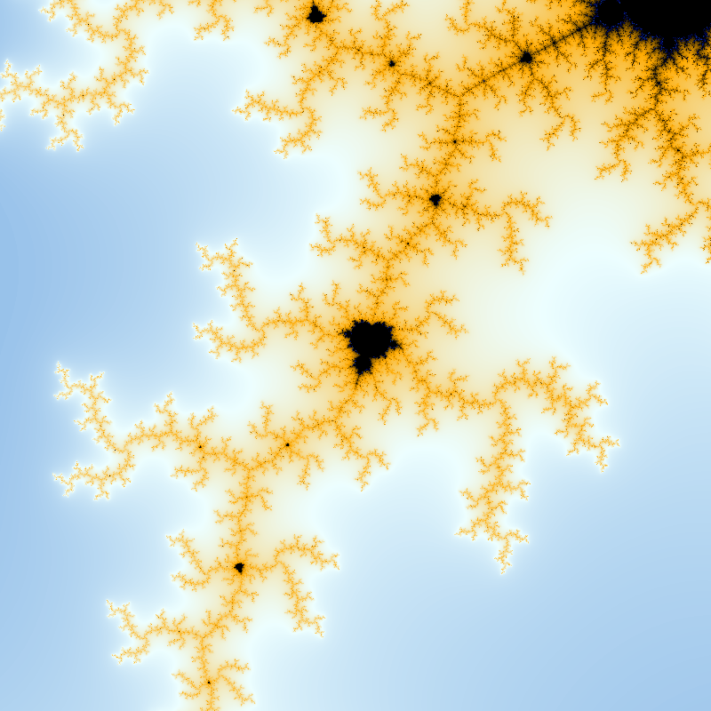
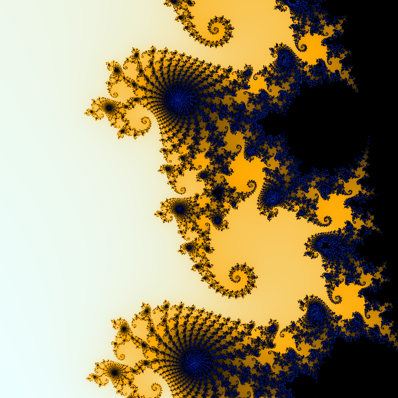

# mandelbrot-viewer

| | | |
|:-:|:-:|:-:|
|  |  |  |
| `./main -w 800 -h 800 -x -0.765 -y 0 -s 0.00375` | `./main -w 800 -h 800 -x -0.572 -y 0.48 -s 6.25e-05` | `./main -w 800 -h 800 -x 0.2825 -y 0.0095 -s 1.5e-05` |
|  |  |  |
| `./main -w 800 -h 800 -x -0.77568 -y 0.13647 -s 1e-06` | `./main -w 800 -h 800 -x -0.1587 -y -1.0331 -s 4.5e-05` | `./main -w 800 -h 800 -x -1.4787 -y 0 -s 2.5e-05` |
|  |  |  |
| `./main -w 800 -h 800 -x -0.9 -y 0.27 -s 0.00015` | `./main -w 800 -h 800 -x -0.235 -y 0.827 -s 3.75e-05` | `./main -w 800 -h 800 -x -0.7463 -y 0.1102 -s 1.5e-05` |
